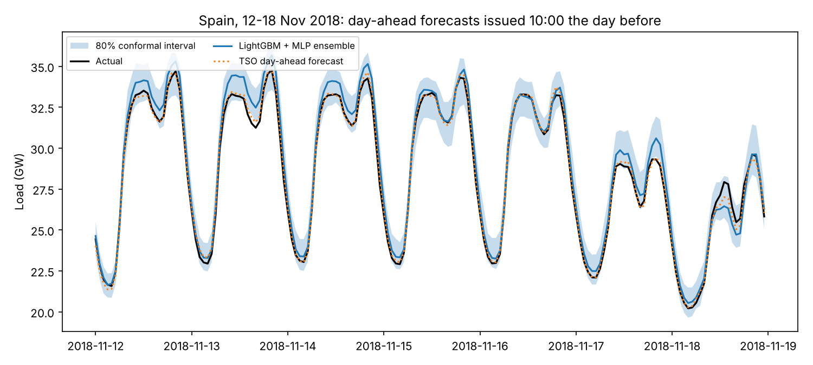
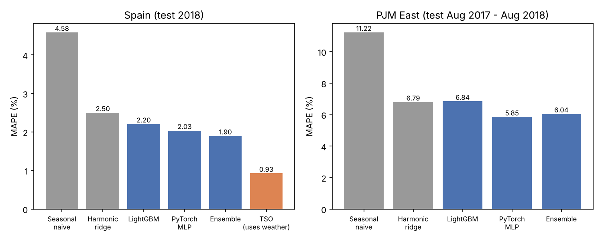

# Day-ahead electricity demand forecasting

Forecasts tomorrow's 24 hourly loads for Spain and PJM East (US), issued at 10:00 the day before, the way grid operators do it. The best model is served through a FastAPI endpoint with 80% prediction intervals, packaged with Docker, tracked in MLflow, and tested in CI.

## Results

Test-set MAPE. The test year was never used for model selection.

| Market | Seasonal naive | Harmonic ridge | LightGBM | PyTorch MLP | LightGBM + MLP | Grid operator |
| --- | --- | --- | --- | --- | --- | --- |
| Spain (2018) | 4.58% | 2.50% | 2.20% | 2.03% | **1.90%** | 0.93% |
| PJM East (Aug 2017 – Aug 2018) | 11.22% | 6.79% | 6.84% | **5.85%** | 6.04% | n/a |

- The best model beats both baselines by a clear margin (Diebold-Mariano, Spain ensemble vs naive p < 1e-12).
- Spain's grid operator still does better. Its forecast uses weather; mine doesn't, because I couldn't get weather data in this environment. That gap is roughly what weather is worth, and it's the obvious next step.
- The 80% intervals cover 83.6% of hours in Spain and 77.9% in PJM.
- **A bug in the public data.** The Spain file has day and month swapped whenever the day is 12 or less. A validation check that compares jumps across midnight on days 1–12 vs 13–31 caught it (1.35× on the raw file, 1.01× after the fix). Fixing it took LightGBM from 5.27% to 2.20% MAPE.
- **Retraining didn't help.** Replaying PJM's test year day by day: 6.84% with a static model, 6.77% retraining monthly, 6.80% retraining on alerts. The alerts line up with heat waves and cold snaps, so the problem is missing weather, not drift.





## How it works

```
data.py        load, fix timestamps, validate
features.py    lags and calendar features, all cut off at 09:00 the day before
models.py      seasonal naive, harmonic ridge, LightGBM, conformal intervals, PyTorch MLP
train.py       fit, score, Diebold-Mariano tests, MLflow, save the serving model
monitoring.py  day-by-day replay with three retraining policies
app/main.py    POST /forecast
```

No feature can see data after the issue time. `tests/test_pipeline.py` checks this by changing everything after 10:00 on the previous day and asserting the features stay the same. The API applies the same cutoff, and its output matches the offline test predictions exactly.

## Run it

```bash
pip install -r requirements.txt
make data
make train      # logs to sqlite:///mlflow.db
make monitor
make test
make serve      # http://localhost:8080/docs
make docker
```

```bash
curl -X POST localhost:8080/forecast -H 'Content-Type: application/json' -d @example_request.json
```

## Data

- **Spain**: hourly load and the operator's day-ahead forecast, 2015–2018 (ENTSO-E, from the darts repo).
- **PJM East**: hourly load, 2002–2018.

## Limitations

- No weather inputs yet.
- I haven't built the Docker image myself (there was no Docker daemon where I developed this). `make docker` builds it.
- To deploy to Cloud Run, add `GCP_PROJECT` and `GCP_SA_KEY` as repo secrets; the weekly retrain workflow handles the rest.
